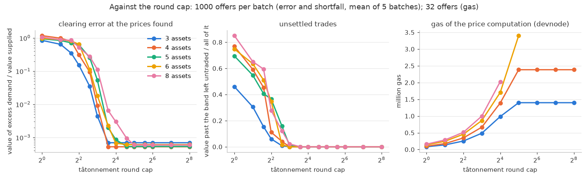
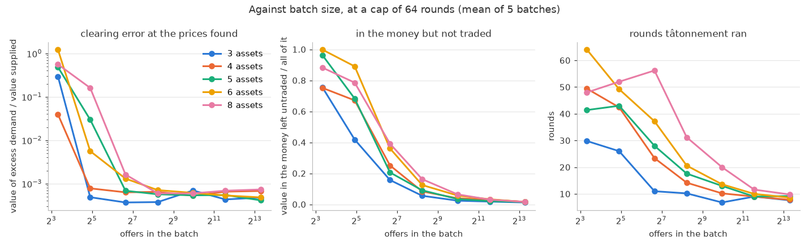
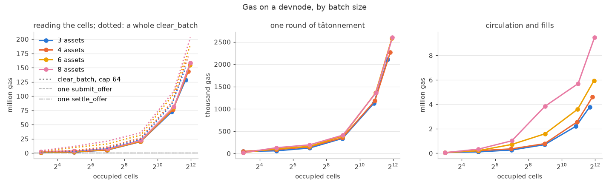

# Speedex

An example port (not for production) of [SPEEDEX], a batch exchange, to Groundhog: several assets,
one set of valuation prices per batch, and every offer in the batch trading at those prices.

- [`engine`](src/engine.rs): the arithmetic -- the limit-price grid, tâtonnement over aggregate
  supply and demand, the circulation that turns its prices into exact trades, and the rule that
  settles one offer. Plain functions over plain numbers, with no storage behind them, tested on their
  own in [`tests/engine.rs`](tests/engine.rs).
- [`contract`](src/contract.rs): the exchange -- escrow, the per-batch histogram, the clearing
  record, and settlement -- tested end to end against the `erc20` example in
  [`tests/batch.rs`](tests/batch.rs), and on the RV32 artifact in
  [`tests/test_rv32.rs`](tests/test_rv32.rs) (`groundhog test -p speedex`).

## What SPEEDEX is

A conventional exchange keeps an orderbook per pair of assets and matches offers one at a time, in
arrival order. SPEEDEX instead collects offers into a batch and finds one *valuation* per asset --
`p_A`, `p_B`, `p_C`, ... -- such that at the exchange rates those valuations imply (`p_A / p_B`
units of B per unit of A), the amount of every asset offered for sale is met by the amount of it
that other offers want to buy. Every offer whose limit price the batch rate beats then executes, all
at that same rate.

Two things follow. There is no ordering inside a batch, so there is nothing to front-run and offers
commute. And an offer to sell A for B can be filled by someone selling B for C and someone else
selling C for A: the valuations clear a ring of trades that no pairwise orderbook could match
(`tests/batch.rs::ring_trade_clears_through_three_assets`). That is why this example insists on at
least three assets -- with two, a batch is just a call auction.

The valuations are found by *tâtonnement*: start anywhere, raise the price of whatever is
over-demanded, lower the price of whatever is over-supplied, repeat. Demand is a step function of
price (an offer executes or it does not), so SPEEDEX smooths each step over a narrow band, which
gives the iteration a gradient to follow; and since the prices it finds are only approximately
clearing, a final pass makes the trades exactly feasible, so that the exchange never pays out more
of an asset than it took in. SPEEDEX uses a linear program for that pass; see below for what this
example does instead.

## How it is laid out on Groundhog

Groundhog executes a block's transactions against the state the block began with and then merges
their writes, so a contract runs in parallel exactly to the extent that its writes are *blind
deltas* -- an `NNInt` increment, a fresh key -- rather than values one transaction must read after
another wrote. SPEEDEX's structure maps onto that almost directly, because the price computation
depends only on the batch's aggregate supply and demand, never on individual offers or their order.

**Submitting an offer** (`submit_offer`) escrows the seller's tokens (from an allowance to the
exchange), rounds the limit price up to a grid level, and adds the amount to one histogram cell:
this batch, this orderbook (sell asset, buy asset), this level. The cell is an `NNInt`, so any
number of offers land in one block without contending. The offer itself is recorded under an id
that names its submission and commits to its contents. Offers join the batch of the block they are
made in (batches span `epoch_len` blocks), and can be cancelled until the batch closes.

**Clearing a batch** (`clear_batch`) runs once, after the batch's last block, and may be run by
anyone: it is a pure function of the histogram, so everyone gets the same answer. The grid is far
too fine for a clearing to read every cell, so the caller lists the occupied ones (`cell_of` gives
the key of each; any reader of the batch's submission events can build the list). The contract
checks the list against a per-orderbook total that submissions also maintain -- a list that leaves
out an occupied cell sums short and is refused as a `BatchMismatch`, so an incomplete list can only
fail, never clear a different batch. It then runs the engine over the listed cells and records the
resulting prices and each orderbook's trades. This is the one thing in the design that runs alone,
and its cost grows with the number of distinct limit prices in the batch, not with the number of
offers.

**Settling an offer** (`settle_offer`) pays one offer from that record and its own entry: what it
bought, and a refund of what it did not sell. It touches nothing another settlement touches, so a
batch's offers settle in any order, any number to a block, alongside the next batch's submissions.
Anyone may settle any offer; the proceeds go to its owner.

The parallelism is therefore the same as SPEEDEX's own: everything is order-free except one small
per-batch step whose cost is independent of load.

## Simplifications

- **A price grid.** Limit prices live on a geometric grid, `2^level_bits` levels to the doubling
  (up to 65536, a step of about one part in ninety thousand), over `octaves` doublings either side
  of one (`engine::Grid`). That is what makes an orderbook a histogram rather than a sorted list. An
  offer's limit is rounded *up* to the next level, so a seller never trades below what it asked, but
  may occasionally miss a trade it would have taken.
- **One-shot offers.** SPEEDEX keeps unfilled offers resting for later batches. Here a batch is a
  one-shot auction: what it does not fill is refunded at settlement, and the seller may resubmit.
- **No fee, and the LP as a circulation.** SPEEDEX's linear program picks how much each orderbook
  trades so that no asset is paid out beyond what was sold of it. Without a fee those constraints
  sum to zero across assets, so they hold with equality: value in equals value out at every asset,
  and the problem is a circulation on the graph of assets with one edge per orderbook. Its
  constraint matrix is a node-arc incidence matrix, hence totally unimodular, so `engine::clear`
  solves it with the simplex method in exact integers: the tableau stays in `{-1, 0, 1}` through
  every pivot, pivoting is addition and subtraction of `U256` values, and the optimum is integral
  -- no LP solver in floating point. The arcs' upper bounds are kept implicitly, so the tableau
  has a row per asset and two columns per orderbook. Each edge has two arcs: the value of the
  buckets past the smoothing band, which is filled first (weighted so that no exchange of it for
  marginal volume can pay), and the value of the buckets inside the band. Within a
  book, levels fill from the most in-the-money down, and the marginal level's offers share its
  remainder. Rounding at settlement goes the exchange's way by under a unit per offer, and the
  circulation makes what the exchange must pay out of each asset at most what it took in; the dust
  simply stays. Where every book on a cycle is past the band, approximate prices cannot balance
  the cycle exactly and a little of it goes unfilled; the clearing reports that value as its
  `shortfall`.
- **Tâtonnement by sign, from equal prices.** SPEEDEX warm-starts from the previous block and lets
  the proposer's result stand. Here every clearing starts from equal prices, so that the clearing
  is a pure function of the batch. A market of limit offers is one of gross substitutes -- raising
  an asset's price only ever adds to its supply and takes from its demand -- and in such a market a
  price that moves with the sign of its excess demand closes in on the equilibrium; but no
  *observable* error does so monotonically (a book whose asks are all out of the money adds the
  same value of excess demand whatever the price, until the price reaches them), so a search that
  discards steps for not improving the error stalls. `engine::tatonnement` discards none: each
  asset keeps its own step, grown while its direction persists and halved when it reverses, and
  the prices returned are the best seen. A batch in which no offer executes at equal prices can
  execute nothing at any prices -- every offer would want more than one of its buy asset per unit
  sold, and a trade is a cycle of sales whose rates multiply to one -- so such a batch returns at
  once and refunds everything. The cap on rounds is part of the exchange's configuration; see
  below for what it buys.

## Bounds

Prices are Q32 fixed point, normalized so the largest is `2^56` and none is below `2^8`, so no rate
exceeds `2^48`; offers are between `2^16` and `2^80`. Within those, every per-offer product fits
`u128`. A histogram cell is an `i128` and may total anything up to `i128::MAX` (the increment
refuses more); the circulation works in value, amount times price, which is under `2^184` per
edge and is exact in `U256`. The grid bounds the rates that can actually trade far more tightly
than that.

A clearing reads at most `max_clear_cells(n)` occupied cells. A batch with more distinct
(orderbook, level) pairs than that cannot be cleared, so a deployment that expects such batches
must choose a coarser grid, a shorter epoch, or more memory: the bound is the guest's memory,
which the artifact declares (`initial_memory_bytes` in `Cargo.toml`, the protocol's 64 KiB unless
stated) and the contract reads back at run time from the linker's end-of-memory symbol. The
guest's allocator never frees, so everything a clearing allocates has to fit at once. Measured on
the RV32 executor (`tests/test_rv32.rs::largest_clearing_fits_the_guest_rv32`), 43.7 KiB is
spoken for before an entry point runs (a 30 KiB stack reserve, the runtime's and the SDK's own),
and a clearing then takes some 5 KiB, 32 bytes per bucket and about 240 bytes per orderbook (its
edge of the value graph in `U256`, its fill, and its two columns of the simplex tableau); the cap
keeps a tenth of the rest in hand. With 64 KiB that is 300 cells for three assets and 130 for
eight; with 256 KiB, about 6,100 and 5,600. A chain
admits a larger declaration through its `max_rv32_memory_bytes` parameter. The mock executor the
RV32 tests run on verifies artifacts under the protocol defaults whatever the environment is
configured with (hogd's `test_ffi`), so the committed manifest keeps 64 KiB and the benchmark
builds its larger artifact from a copy. Gas is the other bound on a batch; see below.

The chain caps a contract's code at 64 KiB, and RV32 has no 128-bit multiply or divide, so the
engine's arithmetic is expensive in code. The engine's routines are `#[inline(never)]` so that each
exists once rather than once per entry point, and the workspace `Cargo.toml` builds this package at
`opt-level = "s"`.

## Measuring it

Two benchmarks, both `#[ignore]`d, put numbers on the trade-offs; `scripts/speedex-bench.sh` runs
both and `scripts/speedex-plot.py` graphs their CSVs. The figures in [`bench/`](bench/) are one
such run.

[`tests/quality.rs`](tests/quality.rs) runs the engine natively over synthetic batches -- offers
whose limits scatter around a hidden set of true valuations (`tests/synthetic`), 3 to 8 assets, 10
to 10,000 offers, five batches of each -- at every tâtonnement round cap from 1 to 256, and
reports for each: the *clearing error* at the prices found (the value of the excess demand,
relative to the value supplied), the *shortfall* (the value of buckets past the smoothing band
that could not trade, relative to all of them), the fraction of the value in the money that
traded, how many offers in the money filled in full, in part or not at all, and how far the prices
sit from the truth. Reading the run in `bench/`:

- Tâtonnement converges to the engine's tolerance (a clearing error of one part in a thousand)
  in 7 to 30 rounds for batches of a hundred offers or more, and then stops; a cap beyond that is
  never used. Small batches of ten offers are the exception: with so few, steps of supply and
  demand can be too coarse for any price to balance, and some of the value past the band goes
  unfilled whatever the cap.
- Below the rounds a batch needs, quality falls off fast: at 4 assets and 1,000 offers a cap of 4
  leaves a 31% clearing error and 11% of the must-trade value unfilled, a cap of 8 leaves 1% and
  none, and from 12 on the run is converged.
- With prices converged, no bucket past the band goes unfilled (a shortfall of zero) in every
  batch of 100 offers or more, and 84% to 98% of the value in the money trades; what does not is
  the marginal buckets inside the band, which the circulation fills only as far as the cycles
  balance.





[`tests/testkit_gas.rs`](tests/testkit_gas.rs) measures the contract itself, on a local devnode
through `groundhog-testkit`, because the mock environment does not meter gas as a node does. For
3 to 8 assets and 8 to 4,096 offers it submits a synthetic batch (a thousand offers to a block,
within one epoch), closes it, and has the contract run the clearing at each round cap through
`measure_clearing` -- an entry point that does everything `clear_batch` does but record the
result, and reports the gas of reading the cells, of tâtonnement and of the circulation
separately (it is also how a clearer can learn what a clearing will cost before paying for it).
A real `clear_batch`, a `submit_offer` and a `settle_offer` are measured from their receipts.
Three things about the node's tooling shape the benchmark, and `scripts/speedex-bench.sh` handles
them: the artifact is built declaring 256 KiB of guest memory and the devnode is started admitting
it; the clearings are signed by the benchmark itself as calls from the agent's key-pair account
through the node's default wallet, since the testkit gives each call it sends 10M gas; and each
asset count runs on a devnode of its own, since an account may have 8,000 transactions at one
expiry height. What the run in `bench/` says:

- Reading the histogram dominates for few assets: about 30k to 39k gas per occupied cell, almost
  all of it the storage read itself (a cold database load is 37,300 in hogd's gas table; a warm
  one is 200), plus one such read per orderbook for the totals. A batch of 4,096 cells costs
  128M gas to read; a submission costs 183k and a settlement 213k.
- A round of tâtonnement costs about 1k gas per bucket plus some 20k to 50k for the price update
  (RV32 has no 128-bit divide, and a round takes one per asset), so the price computation of a
  converged clearing stays well under the reads at any size: 15M at 4,096 cells.
- The circulation is a few dozen simplex pivots over a tableau of `n` rows and two columns per
  orderbook, each an integer pass over it plus a `U256` addition per row: under 1M gas at 128
  cells and 9.5M at 4,096 cells with eight assets (a cycle-cancelling predecessor took 150M
  there), the rest of it the pass over the buckets that builds the edges and the fills.
- Altogether a converged clearing costs from 2M gas (three assets, 8 cells) to 150M (three
  assets, 4,096 cells) and 203M (eight assets, 4,096 cells): reads first, then tâtonnement. A
  deployment should set the grid, the epoch, the round cap and the number of assets against what
  its chain's gas limit affords.



## Running

```sh
cargo test -p speedex                        # engine and contract tests, natively
groundhog build -p erc20 -- -F metadata      # the RV32 artifacts the next line loads
groundhog build -p speedex
groundhog test -p speedex                    # the ring trade, and the largest clearing, on RV32
scripts/speedex-bench.sh                     # the benchmarks above (devnode: groundhog toolchain install)
```

[SPEEDEX]: https://www.usenix.org/conference/nsdi23/presentation/ramseyer
