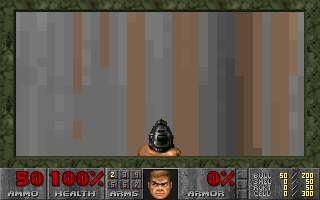

# Doom in a Groundhog contract

This internal demo runs original Doom Episode 1 in a **freestanding RV32 C
contract**, including the original 320×200 software renderer. It boots E1M1,
accepts keyboard input, advances one deterministic game tic per call, saves
changed memory pages to contract storage, and publishes indexed-color frames.



The contract runs successfully in hogd's **unchanged production
`ThreadedMachine` interpreter**. The supplied runner provides an in-memory
implementation of the handful of Groundhog syscalls the contract uses. It is
not a deployed chain: database RPC, storage-token accounting, signing,
scheduling, consensus, and live gateway integration remain to be exercised.

## Run it

Linux, Python 3.10+, git access to `groundhogchain/hogd`, and OpenSSL's
`libcrypto` development package are required. The harness uses Zig's bundled
Clang and C++ library; no Rust SDK or libc is needed inside the guest.

From this directory:

```sh
python3 -m venv .deps/venv
. .deps/venv/bin/activate
python -m pip install -r requirements.txt
python build.py

# Executes 1,050 gameplay tics and the persistence/failure regressions.
build/runner build/doom.rv32a .deps/PureDOOM/doom1.wad build/evidence 1050
python test_server.py --wad .deps/PureDOOM/doom1.wad

# Play locally. Open http://127.0.0.1:8765 in your browser.
python serve.py --wad .deps/PureDOOM/doom1.wad
```

`build.py` checks out the revisions in [sources.json](sources.json). It also
accepts `--hogd-dir /path/to/hogd`, `--puredoom-dir /path/to/PureDOOM`, and
`--zig /path/to/zig`. Existing checkouts are never modified; the script verifies
the pinned VM file hashes and rejects mismatches. Use a separate checkout if
your main development checkout has moved on. PureDOOM supplies the shareware
WAD used in these measurements; another user-provided `doom1.wad` can be passed
to the runner/server. Engine source and WAD data are fetched separately and
are not vendored here.

The viewer targets 35 tics/second, supports pause and single stepping, and
uses the arrow keys, Ctrl (fire), Space (use), Shift (run), and Esc (menu).
The local server starts a new game when restarted. Its in-memory storage is
a test service, not durable chain storage.

## Limits to change for a fresh demo chain

These values refer to the pinned hogd/protocol sources, not an inferred live
network configuration. The concrete local-checkout patch is
[hogd-demo.patch](hogd-demo.patch), which changes four values in
`hogd/genesis/genesis_configuration.cc::stock_network_config()`.

| Setting | Current stock/default | Demo setting | Why |
|---|---:|---:|---|
| `max_rv32_code_bytes` | 65,536 | 1,048,576 | Built guest code: 610,520 bytes |
| `max_rv32_memory_bytes` | 65,536 | 16,777,216 | Guest declares 16 MiB for stack, statics, zone/arena and scratch |
| `max_contract_size_bytes` | 262,144 | 1,048,576 | Artifact: 797,232 bytes, including initialized data |
| `max_bytestring_len` | 1,024 | 32,768 | WAD and snapshot pages use 32 KiB storage items |

Apply the patch to a disposable hogd checkout, rebuild `hog-devnode`, and
create **fresh genesis/state**. The bootstrap paths inspected here use
`stock_network_config()`; this is a source patch, not an invented CLI flag.
The current configuration is committed at genesis and this code has no
post-genesis configuration-update path. The patch is supplied for review and
has been checked against the pinned source; a full hogd build/live launch has
not been run here.

```sh
# From an isolated hogd checkout at the pinned revision:
git apply /path/to/groundhog-examples/experiments/doom/hogd-demo.patch
```

All four proposed values fit the existing ceilings: 4 MiB code, 16 MiB memory,
1,900,000 contract bytes, and 65,000 bytes per bytestring. The artifact fits
the transaction envelope without raising its limit. The WAD is 4,196,020 bytes
and is uploaded in 129 calls; it is not embedded in the deployment artifact.
The initial snapshot writes about 4.59 MB, below the 16 MiB executor-to-DB
message budget, before envelope overhead. No gas schedule/digest changes are
needed to admit this contract.

Start with **200 million gas for initialization and 50 million per tick**.
These are generous experimental budgets, not calibrated live-node minimums.
The harness excludes DB RPC charges; at the pinned v4 price, 141 charged DB
RPCs alone would add about 5.26 million gas. Actual cache behavior, extra
storage operations, wallet overhead, and storage funding must be measured on
the node. Fund the contract for WAD and snapshot storage as well as execution.

The original simulation rate is **35 Hz**, or **28.57 ms/tic**. The inspected
CLI supports `groundhog node --block-driver interval --block-interval-ms 29`,
or instant production driven by a client paced at 35 Hz. A 29 ms timer is only
an approximate 34.48 Hz target; it does not guarantee that blocks finish that
quickly. One session has sequential state dependencies; faster independent
execution threads do not accelerate one game's tics. Lower render frequency
or batching several tics per transaction are later options if live storage
or consensus dominates. Neither batching nor skipped rendering is implemented
in this first version.

The **return buffer is separately capped at 1,024 bytes** in
`protocol/transaction.x`. This prototype keeps that cap: method 3 returns one
of 64 chunks. A full frame is 64,000 indexed pixels + 768 palette bytes =
64,768 bytes. A full-frame-return variant needs that protocol cap raised (and
its generated types/clients rebuilt); changing the bytestring limit alone
does not change it. The local viewer reads the two stored frame pages from
its test host directly. A live viewer should batch storage reads at one
committed tip or implement a larger frame-return path rather than instantiate
64 separate 16 MiB VMs for each displayed frame.

## Measured result

[Raw measurements](evidence/metrics.csv), [summary](evidence/summary.json),
[artifact sizes](evidence/artifact.json), and
[provenance](evidence/provenance.json) are checked in. The sample is 1,050
tics (30 seconds of game time) on one Linux x86-64 host. It moves forward,
turns, then fires; it is not a worst-case level/scene benchmark.

| Measurement | Result |
|---|---:|
| Initialization | 46.17 ms; 46.74M gas excluding DB RPC |
| Tic wall time, median / p95 / maximum | 11.01 / 12.51 / 23.76 ms |
| Tic gas, median / maximum, excluding DB RPC | 6.70M / 7.17M |
| Storage bytes read per tic, median | 4,587,600 |
| Storage bytes written per tic, median / maximum | 392,528 / 621,904 |
| Storage gets / sets per tic, median | 141 / 13 |

Wall time includes fresh VM construction, contract execution, OpenSSL hashing,
local storage lookup/copy, and commit to the in-memory store. It excludes
program translation, which is done once before calls, and excludes real
database/network/consensus work. This provides headroom within the original
28.57 ms tic budget, but **does not establish 35 FPS on a live chain**.

At 35 Hz, the median workload alone implies approximately 161 MB/s of storage
reads and 13.7 MB/s of writes per session before protocol overhead. That
state traffic is the main thing to investigate next; merely shortening the
block timer will not remove it.

## Contract design and ABI

The implementation is [contract.c](contract.c). It implements the existing
register-native syscall ABI directly; [start.S](start.S) sets the stack and
dispatches the method ID supplied in `a0/a1`. [link.ld](link.ld) lays out the
guest, and [package.py](package.py) packages its sections into artifact v5,
entry ABI v3, syscall ABI v1, and the pinned v4 gas digest. The stock SDK
linker currently fixes guest memory to 64 KiB and is not used here. This is an
experimental custom C build/package path, not a `groundhog build` Cargo crate.

Calldata is raw little-endian, not the SDK's default XDR method encoding.
Method IDs below are numeric u64s; their eight-byte entrypoint IDs are the
little-endian representation (e.g. step = `0200000000000000`).

| ID | Method | Calldata | Return |
|---:|---|---|---|
| 0 | Upload WAD page | `u32 page_index`, `u32 total_wad_bytes`, page bytes | `u32 uploaded_pages`, `u32 total_wad_bytes` |
| 1 | Initialize E1M1 | Empty | 80-byte metadata |
| 2 | Step exactly one tic | `u32 expected_tick`, 32-byte bitmap of 256 held keys | 80-byte metadata |
| 3 | Read frame chunk | `u32 expected_tick`, `u32 chunk_index` (0–63) | Up to 1,024 bytes |
| 4 | Read status | Empty | 80-byte metadata |

Metadata: `u32 version`, `u32 tick`, `u32 snapshot_bytes`, `u32 wad_bytes`,
then a 64-byte bitmap of present snapshot pages. The first frame is tic 1.
The key bitmap uses PureDOOM's key IDs; bit `k % 8` in byte `k / 8` is key `k`.

Each 32-byte storage key is the 16 ASCII bytes `groundhog-doom-v1`, followed
by little-endian u32 domain, little-endian u32 index, then eight zero bytes.
Domains: 0 metadata (index 0 game, index 1 upload), 1 WAD, 2 snapshot, 3 frame.

The WAD reader is a virtual read-only file backed by contract storage, with
one page of per-call cache. Upload is append-only and sealed after successful
initialization. The engine receives a deterministic clock, preserves Doom's
own random-generator state, and never reads a host clock or host file. Audio
output is omitted. Cosmetic screen-wipe waiting is skipped so a step does not
spin until wall-clock time passes.

The snapshot covers writable globals and the used allocator arena, excluding
the active stack, immutable code/rodata, and per-call scratch. All engine
pointers are RV32 offsets and restore to the same guest addresses. SHA-256
identifies changed pages; all-zero pages are omitted and represented in the
metadata bitmap. Heap/BSS zero-fill comes from a fresh VM. A metadata tick
check rejects stale concurrent/retried inputs. The chain transaction boundary
must commit/roll back all page and metadata writes atomically.

This is one shared demo session per contract address. It intentionally has no
player ownership/authorization layer. It accepts input from callers and
allows initial WAD setup on the fresh address. It must not be presented as an
authenticated multiplayer contract. The outer 8 MiB arena is bounded but
uses a bump allocator; Doom's zone allocator performs its own internal frees.
Long sessions and repeated level changes may exhaust outer allocations and
need a proper reclaiming allocator. Snapshot layout is tied to this exact
artifact; it is not a portable save-game or contract-upgrade format.

## What passed, and what remains

The runner checks actual RV32 decoding/execution; independent fresh-VM
restore/replay produces identical storage and gas. Different input changes
the rendered frame. Stale ticks, a second initialization, WAD mutation after
sealing, malformed inputs, and unknown methods are rejected. A call that
runs out of gas **after page writes** leaves the committed store unchanged,
then succeeds on retry. All 64 frame chunks reconstruct the stored frame.
The HTTP test checks real movement and invalid/stale requests through the
server. Python compilation and viewer JavaScript syntax checks also pass.

The browser environment used during development denied the preview server's
listening socket, so interactive browser input/layout validation is still
outstanding. The HTTP loop itself was tested in the native execution
environment. The private devnode release was unavailable to the local
downloader, so deployment and a live storage/consensus run remain outstanding.
The existing Rust workspace CI does not execute this experimental C harness;
run the commands above when changing it.

Next integration work is to apply the demo genesis configuration, deploy the
artifact with a matching v4 runtime, submit the documented raw calldata using
a signed client, and connect the viewer to committed frame storage. Then
measure cold and warm node execution, storage-token requirements, and
end-to-end input-to-frame latency before claiming live 35 FPS.

## Source/license provenance

PureDOOM is an external original-Doom source port, pinned in `sources.json`.
Keep its upstream Doom Source Code License notices and the WAD's separate
distribution terms. The examples repository's Apache license does not
relicense that engine or game data. The experiment is intended for the
requested internal demo; engine source, WAD, and built engine binaries are
not committed in this PR.

Relevant sources:

- [Pinned hogd RV32 bounds and instruction costs](https://github.com/groundhogchain/hogd/blob/2ced81d979b90f8f70847581d2db965145b22865/hogd/hog_exec/runtime/rv32/program.h)
- [Pinned network configuration parameters](https://github.com/groundhogchain/protocol/blob/63c9284d8d5727e8355b0b3d01e5e40f15478a89/network_config.x)
- [Bytestring default and ceiling](https://github.com/groundhogchain/protocol/blob/63c9284d8d5727e8355b0b3d01e5e40f15478a89/storage_item.x)
- [Return-buffer limit and raw calldata](https://github.com/groundhogchain/protocol/blob/63c9284d8d5727e8355b0b3d01e5e40f15478a89/transaction.x)
- [PureDOOM source and portability API](https://github.com/Daivuk/PureDOOM/tree/355cfbd16fac119718879239336ee2ea408886bd)
