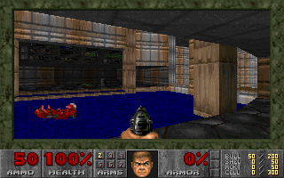

# Doom in a Groundhog contract

This internal demo runs original Doom Episode 1 in a **freestanding RV32 C
contract**, including the original 320×200 software renderer. It boots E1M1,
accepts keyboard input, advances one deterministic game tic per call, saves
changed memory pages to contract storage, and publishes indexed-color frames.



The contract runs on a real local `hog-devnode`, behind `groundhog node`'s
JSON-RPC service. The browser sends held keys to a local Python bridge; each
tick is a signed transaction, and the bridge reads the resulting pixels from
committed contract storage. The standalone VM harness is also retained.

## Build the contract

Linux x86-64, Python 3.10+, git access to the private Groundhog repositories,
and OpenSSL's `libcrypto` development package are required. From the repository
root:

```sh
git submodule update --init experiments/doom/vendor/PureDOOM experiments/doom/vendor/hogd experiments/doom/vendor/groundhog-rpc
cd experiments/doom
python3 -m venv .deps/venv
. .deps/venv/bin/activate
python -m pip install -r requirements.txt
python build.py
```

All three external repositories are pinned git submodules. No recursive
checkout is needed for the contract and standalone runner. `build.py` verifies
the pinned PureDOOM revision and the eleven VM file hashes in
[sources.json](sources.json). It also accepts `--hogd-dir`, `--puredoom-dir`,
and `--zig` overrides. Zig 0.16.0 supplies the guest compiler and host C++
runtime; the guest does not need the Rust SDK or libc. Engine source and the
shareware `doom1.wad` remain in the PureDOOM submodule.

## Run the real node and browser app

The required changes are [groundhog-rpc #348](https://github.com/groundhogchain/groundhog-rpc/pull/348)
and [hogd #4035](https://github.com/groundhogchain/hogd/pull/4035). The submodules
pin these changes. They add CLI configuration overrides and gas-budget options;
no source patch to the stock network defaults is needed.

For this demo, Linux x86-64 executables and their runtime libraries are built
by CI. Download the two artifacts using authenticated `gh`:

```sh
mkdir -p .deps/node .deps/rpc
gh run download 34704874736 -R groundhogchain/hogd -n doom-devnode-linux-x86_64 -D .deps/node
# Matching CLI and native pubkey signer:
gh run download 34705779929 -R groundhogchain/groundhog-rpc -n local-demo-cli-linux-x86_64 -D .deps/rpc
(cd .deps/node && sha256sum -c doom-devnode-bundle.tar.gz.sha256 && tar --no-same-owner -xzf doom-devnode-bundle.tar.gz)
(cd .deps/rpc && sha256sum -c local-demo-cli.tar.gz.sha256 && tar --no-same-owner -xzf local-demo-cli.tar.gz)

python run_node.py \
  --groundhog .deps/rpc/local-demo-cli/bin/groundhog \
  --signer .deps/rpc/local-demo-cli/bin/pubkey-signer \
  --hog-devnode .deps/node/doom-devnode-bundle/bin/hog-devnode \
  --contracts .deps/node/doom-devnode-bundle/contracts
```

Open **http://127.0.0.1:8765** after the launcher prints “Play at”. The launcher
starts an instant-block local node, deploys and funds Doom, uploads the WAD,
initializes E1M1, funds the native signer for replay storage, and serves the app. It stores chain data, logs, and transaction
receipts in `build/local-node`. Stop with Ctrl-C; the same command resumes the
saved game when node recovery succeeds. One intermittent recovery failure is
tracked in [hogd #4037](https://github.com/groundhogchain/hogd/issues/4037); the
latest smoke run did recover and continue. For this internal demo, use another
`--data-dir` if a restart fails. Changing genesis overrides
on an existing node directory is rejected.

Use a **fresh `--data-dir`** when moving from earlier versions of this demo:
the optimized artifact uses snapshot version 2 and 64,000-byte storage entries.
The launcher defaults to two hogd workers for this serial game loop; override
with `--worker-threads N`. This sets the existing `DEFAULT_THREADPOOL_SIZE`
environment parameter, and does not change prepared-code cache behavior.

Use the **RPC bundle's `groundhog`**, paired with the node bundle's `hog-devnode`
and contracts. The older CLI also included in the node bundle uses a different
protocol version. Each bundle has a file-hash manifest. CI artifacts expire
after seven days; the checked-in workflows can rebuild them. To build from
source, follow the pinned hogd build instructions (including its recursive
submodules), then build the matching RPC checkout with private registry access:

```sh
(cd vendor/groundhog-rpc && cargo build --release --locked -p groundhog-cli && cargo build --release --locked -p groundhog-signing --example pubkey_signer)
```

Pass those binaries and hogd's built contract directory to `run_node.py`.
The signer example is a persistent JSON-lines process using Groundhog's Rust
signing and CXS libraries. Calls enter the undeployed pubkey account's native
`DefaultWallet.execute` and then invoke Doom. It uses the public deterministic
dev-1 key for this disposable local demo. Deployment and initial funding still
use the CLI's local dev wallet.

The native wallet uploads 129 WAD pages of up to 32 KiB. Omitting `--signer`
uses the stock RV32 dev wallet and 2,049 fragments of up to 2 KiB, because that
wallet has a small calldata buffer. Both paths have been exercised on the
node. Upload modes cannot be mixed on an unfinished contract.

The viewer targets 35 ticks/s and supports pause, single stepping, arrow keys,
Ctrl (fire), Space (use), Shift (run), and Esc (menu). It sends one input at a
time; if a tick takes longer than 28.57 ms, gameplay slows down. Audio is omitted.

For a node already running, use `live.py --help` to supply its RPC URL,
runtime manifest, CLI, signer, and optional existing funded contract address.

## Configuration and bandwidth

The launcher passes these four overrides to `groundhog node`:

| Setting | Stock | Demo |
|---|---:|---:|
| `max_rv32_code_bytes` | 65,536 | `1M` |
| `max_rv32_memory_bytes` | 65,536 | `16M` |
| `max_contract_size_bytes` | 262,144 | `1M` |
| `max_bytestring_len` | 1,024 | `64000` |

Each is a repeated `--network-config NAME=VALUE` argument. These values fit
existing compiled ceilings, which remain enforced. The current artifact is
about 0.80 MB and declares 6 MiB of guest memory; the 4,196,020-byte WAD is
uploaded separately. The initialization call gets 200M gas, and each tick
gets 50M gas. These are tested budgets, not measured minimums; receipt gas
consumption is not currently exposed. `groundhog call --gas-limit` now lets
other callers set the budget too.

The protocol return-data cap stays at 1,024 bytes. The live bridge reads the
80-byte metadata and two stored frame pages, requiring all three reads to
report the same committed block height. These reads use one JSON-RPC batch
over a reused HTTP connection. It retries if the chain advances
between reads. This avoids invoking 64 frame-chunk calls.

Browser traffic per displayed frame is **64,804 bytes**: 64,000 indexed pixels,
768 palette bytes, and a 36-byte metrics header, before HTTP overhead. That is
about **2.27 MB/s at 35 Hz**. The raw contract input is 36 bytes; the browser
uses a small JSON envelope. The roughly 4.0 MB of storage read inside the
node each tick never goes to the browser. The bridge currently receives
hex-encoded frame storage through JSON-RPC, so node-to-bridge wire traffic is
larger than the binary browser response.

## Measurements and verification

The latest [optimization evidence](evidence/speed-up.json) compares 105 live
game ticks per version on the same host and the same unmodified node/CLI
binaries. Each version runs separately, with its own fresh node and no
concurrent benchmark. The input sequence is identical; initial and final
committed frames match byte for byte.

| Full input-to-frame loop | Previous 10 MiB demo | Optimized demo |
|---|---:|---:|
| Mean latency | 58.35 ms | 38.16 ms |
| Aggregate rate | 17.14 FPS | 26.21 FPS |
| Median latency | 53.70 ms | 34.79 ms |
| Median transaction latency | 46.03 ms | 29.01 ms |

The earlier short run was about 19 FPS. These fresh measurements include
stalls, and do not include browser drawing/display latency. The optimized
demo remains below the original 35 Hz target. Each tic still uses one signed
transaction and one committed block; no simulation is moved off chain.

The improvements are a 3 MiB Doom zone inside a 4 MiB outer arena (6 MiB total
guest memory), 64,000-byte snapshot entries, persisted page hashes, two local
workers, metadata-only input preflight, batched frame reads and HTTP connection
reuse. The 3 MiB zone passed 1,050 tics with 152 captured frames identical to
the original; a 2 MiB zone failed during gameplay and is not used. The smaller
arena is tested for this E1M1 demo, not every level or extended session.

The final standalone run dropped from roughly 10.65 to 5.66 ms/tic. Median
storage gets dropped from 141 to 65, and bytes read from 4,587,600 to 4,034,288.
Larger pages trade fewer round trips for coarser writes: median bytes written
rose from 392,528 to 579,056. A stored hash table avoids hashing restored
pages again; the contract atomically updates it with the pages, and the
harness independently verifies the hashes against stored page bytes.

Temporary node probes identified about 10 ms in storage reads and 5 ms in
hashing, versus 3 ms in the VM instruction loop, in the intermediate 3 MiB-zone
configuration. Those probes are on a separate profiling branch; the gameplay
comparison above uses the original node binary. No cross-block prepared-code
cache change is included.

The final probes reduced reads to about 6.0 ms and hashing to 2.6 ms. Program
preparation still costs about 5.8 ms per block. The raw phase samples are in
the same evidence file. Run `python test_live_reads.py` for the small batch
ordering and frame-consistency checks without starting a node.

The following measurements are historical and retain their original artifacts:

[evidence/live.json](evidence/live.json) records the deployed contract,
artifact hashes, build revisions, successful receipts, and live measurements.
A real-node smoke test exercises 35 gameplay ticks, changed rendered pixels,
and stale/malformed HTTP input rejection. Add `--restart` to also probe recovery
and continued play (including the intermittent failure above). Run it with the
same binary arguments as the launcher:

```sh
python test_live.py --data-dir build/new-smoke-node \
  --groundhog .deps/rpc/local-demo-cli/bin/groundhog \
  --signer .deps/rpc/local-demo-cli/bin/pubkey-signer \
  --hog-devnode .deps/node/doom-devnode-bundle/bin/hog-devnode \
  --contracts .deps/node/doom-devnode-bundle/contracts
```

| Live measurement, 35 gameplay ticks | Result |
|---|---:|
| Native pubkey transaction time, median / min / max | 52.31 / 45.69 / 138.21 ms |
| HTTP input to returned frame, median / min / max | 61.79 / 52.21 / 153.58 ms |
| Dev-wallet transaction time, earlier 35-tick sample, median | 57.76 ms |

The native path avoids launching a CLI process per tick, but execution and
storage still dominate. Roughly 62 ms per complete client loop corresponds to
about 16 ticks/s here, below Doom's original 35 Hz. Transaction time includes
signing, chain-tip lookup, submission and receipt polling. HTTP time also
includes preflight/committed frame reads, writing the session record and the
binary response; it excludes browser drawing and display latency.

A follow-up [timing profile](evidence/timing-profile.json), using the same
artifact and binaries, measured 47.84 ms/transaction: about 1.5 ms for tip lookup,
signing and submission; 42 ms from block open to event close; and 4.7 ms from
close to receipt observation. These are separate medians, not an exact sum.
A status-only call to the same large contract still took 23.45 ms. The pinned
node clears its prepared-contract cache between blocks, so the one-tic/block
loop reloads and prepares Doom each time; the standalone harness prepares it
once outside the tick timer. A separate warm preparation benchmark cost
6.20 ms. This identifies avoidable preparation work but does not isolate every
millisecond of the remaining executor/storage overhead. Receipt polling gaps
overlap node execution and must not be counted as additional removable time.

The historical 23.45 ms status measurement is a **signed method-4 transaction producing a
block**, not a direct metadata RPC read. A second [control experiment](evidence/status-controls.json)
interleaved 30 status transactions per variant after three warmups each, using
the earlier artifact that declared 16 MiB:

| Status operation | Median end-to-end time |
|---|---:|
| Doom contract, 599,972 bytes of code, 16 MiB guest memory | 28.01 ms |
| Tiny control, 548 bytes of code, same initial data and 16 MiB memory | 23.54 ms |
| Same tiny control, no initialized data, 16 MiB memory | 22.54 ms |
| Same tiny control, no initialized data, 2 MiB memory | 13.93 ms |
| Direct `groundhog_getStorageAt` read of Doom's 80-byte metadata | 0.42 ms |

The controls check empty calldata, read one 80-byte metadata item and return
it. Changing the memory-size parameter changes the tiny control's end-to-end
transaction latency by about 8.6 ms in this run;
replacing Doom's code while retaining its memory image changes it by about
4.5 ms. These are workload comparisons, not exact CPU phase attribution.
The interleaved run has different allocation/cache behavior and host variance
from the earlier Doom-only status sample. The node builds a full zero-filled
guest memory image during preparation and copies that image at invocation,
even for status. The earlier 6.20 ms preparation benchmark includes image
construction as well as code translation. The remaining roughly 14 ms for
the 2 MiB control includes authentication, storage, scheduling, block commit
and receipt observation; these phases are not individually instrumented yet.
The direct reads were measured after a 50 ms quiescence wait. The browser
already reads committed storage directly. No cross-block cache change was made.

That comparison does **not** measure a 22 ms memory initialization. A focused
[lifecycle measurement](evidence/memory-reconciliation.json), using the same
historical artifact in one standalone harness, measured:

| Status lifecycle, 50 warm samples | 16 MiB | 10 MiB |
|---|---:|---:|
| Cached preparation: fresh VM construction and image copy | 0.892 ms | 0.343 ms |
| Rebuild preparation, construct VM, execute status and destroy objects | 7.543 ms | 5.914 ms |

The cached harness's gameplay timer already includes fresh VM construction
and the image copy. It excludes building the prepared image, about 6.21 ms
in the fresh 16 MiB case. Executing the status method itself takes only a
few microseconds with the harness's in-memory storage. The node timings
cannot be attributed to memory setup alone: block/executor/storage overhead
and differing allocation/thread behavior still need internal instrumentation.

That earlier linked data layout ended at `0x9ac018` (9.672 MiB), including the
entire bounded 8 MiB arena and scratch buffers. Its declaration was reduced to
10 MiB, leaving 344,040 bytes beyond the layout. This retained all memory
addresses, heap capacity and engine behavior; a same-build 10/16 MiB comparison
changes only the artifact header's memory-size field. PureDOOM's default
RV32 zone allocator requests 6 MiB inside that arena, so substantially smaller
memories require changing the heap/zone configuration and layout. The node's
`max_rv32_memory_bytes=16M` remains an admission ceiling; it does not force
the smaller artifact to allocate 16 MiB. Use a fresh demo data directory when
deploying the rebuilt artifact. The 10 MiB build passed 1,050 gameplay ticks
and the existing persistence/rollback checks, plus 35 ticks through the real
node and HTTP app. Historical timing evidence retains its original hashes.

`profiling/lifecycle.cpp` includes the same harness and emits separate CSV
spans for preparation, instantiation, method execution and destruction. Build
it like `runner.cpp`, with the pinned hogd include directory and `program.cc`,
then run `build/lifecycle build/doom.rv32a`. It runs 51 samples per mode;
discard sample 0 when computing warm medians. The current artifact uses
6 MiB, while the table above preserves the controlled historical comparison.
Pass a final argument of `1` when profiling an old snapshot-version-1 artifact.

Reproduce the status controls with the matching bundles above and Zig 0.16.0
(the output directory must not already exist):

```sh
python profiling/status.py \
  --groundhog .deps/rpc/local-demo-cli/bin/groundhog \
  --signer .deps/rpc/local-demo-cli/bin/pubkey-signer \
  --hog-devnode .deps/node/doom-devnode-bundle/bin/hog-devnode \
  --contract-artifacts-dir .deps/node/doom-devnode-bundle/contracts \
  --zig /path/to/zig --work-dir build/status-profile
```

The original standalone sample remains in [metrics.csv](evidence/metrics.csv),
[summary.json](evidence/summary.json), [artifact.json](evidence/artifact.json),
and [provenance.json](evidence/provenance.json). It used an earlier artifact
and 1,050 tics on one Linux x86-64 host:

| Standalone measurement | Result |
|---|---:|
| Initialization | 46.17 ms; 46.74M gas excluding DB RPC |
| Tic time, median / p95 / maximum | 11.01 / 12.51 / 23.76 ms |
| Tic gas, median / maximum, excluding DB RPC | 6.70M / 7.17M |
| Storage bytes read per tic, median | 4,587,600 |
| Storage bytes written per tic, median / maximum | 392,528 / 621,904 |
| Storage gets / sets per tic, median | 141 / 13 |

The 11 ms measurement includes fresh VM construction, execution, hashing and
in-memory storage work. It excludes database RPC, signing, block production,
and consensus. **It is not the live node's input-to-frame latency.** Shorter
block timers cannot remove execution/storage overhead. Native 35 Hz remains
a performance target; batching tics or reducing render frequency are possible
future changes, neither implemented here.

Standalone regression and browser-server checks are still available:

```sh
build/runner build/doom.rv32a vendor/PureDOOM/doom1.wad build/evidence 1050
python test_server.py --wad vendor/PureDOOM/doom1.wad
python serve.py --wad vendor/PureDOOM/doom1.wad
```

That runner uses unchanged production RV32 interpreter files with a local
in-memory syscall host. It checks deterministic restore/replay, stale ticks,
malformed calls, sealed assets, frame chunk reconstruction, and rollback after
an out-of-gas failure following writes. `serve.py` starts a new in-memory game
on restart; `run_node.py` uses persistent chain storage.

Interactive browser validation was blocked by the development environment's
loopback/browser policy. The requested escalation was rejected because
sandbox approvals are disabled. The actual HTTP endpoints and committed
frames were tested; keyboard interaction and visual layout still need a
normal local browser. Existing Rust workspace CI does not run the experimental
C harness or the live smoke test automatically.

## Contract design and ABI

The implementation is [contract.c](contract.c). It implements the existing
register-native syscall ABI directly; [start.S](start.S) sets the stack and
dispatches the method ID supplied in `a0/a1`. [link.ld](link.ld) lays out the
guest, and [package.py](package.py) packages its sections into artifact v5,
entry ABI v3, syscall ABI v1, and the pinned v4 gas digest. The stock SDK
linker currently fixes guest memory to 64 KiB and is not used here. This is an
experimental custom C build/package path, not a `groundhog build` Cargo crate.

Calldata is raw little-endian, not the SDK's default XDR method encoding.
Method IDs below are the numeric u64s received by the RV32 dispatcher. Through
the current dev wallet and `groundhog call`, use the eight-byte big-endian ID
(e.g. step = `0x0000000000000002`). Calldata fields remain little-endian.

| ID | Method | Calldata | Return |
|---:|---|---|---|
| 0 | Upload WAD page | `u32 page_index`, `u32 total_wad_bytes`, page bytes | `u32 uploaded_pages`, `u32 total_wad_bytes` |
| 1 | Initialize E1M1 | Empty | 80-byte metadata |
| 2 | Step exactly one tic | `u32 expected_tick`, 32-byte bitmap of 256 held keys | 80-byte metadata |
| 3 | Read frame chunk | `u32 expected_tick`, `u32 chunk_index` (0–63) | Up to 1,024 bytes |
| 4 | Read status | Empty | 80-byte metadata |
| 5 | Upload WAD fragment | `u32 byte_offset`, `u32 total_wad_bytes`, up to 2,048 bytes | `u32 uploaded_bytes`, `u32 total_wad_bytes` |

Metadata: `u32 version` (currently 2), `u32 tick`, `u32 snapshot_bytes`, `u32 wad_bytes`,
then a 64-byte bitmap of present snapshot pages. The first frame is tic 1.
The key bitmap uses PureDOOM's key IDs; bit `k % 8` in byte `k / 8` is key `k`.

Each 32-byte storage key is the 16 ASCII bytes `groundhog-doom-v`, followed
by little-endian u32 domain, little-endian u32 index, then eight zero bytes.
Domains: 0 metadata (index 0 game, index 1 completed WAD pages, index 2 uploaded
WAD bytes, index 3 concatenated 32-byte snapshot-page SHA-256 hashes), 1 WAD,
2 snapshot, 3 frame. Snapshot entries hold 64,000 bytes; WAD and frame pages
remain 32,768 bytes. The hash table covers exactly `snapshot_bytes / 64000`
pages, including SHA-256 of a zero page for pages absent from the bitmap.

The WAD reader is a virtual read-only file backed by contract storage, with
one page of per-call cache. Upload is append-only and sealed after successful
initialization. The engine receives a deterministic clock, preserves Doom's
own random-generator state, and never reads a host clock or host file. Audio
output is omitted. Cosmetic screen-wipe waiting is skipped so a step does not
spin until wall-clock time passes.

The snapshot covers writable globals and the used allocator arena, excluding
the active stack, immutable code/rodata, and per-call scratch. All engine
pointers are RV32 offsets and restore to the same guest addresses. SHA-256
identifies changed pages. The previous hashes are loaded from contract-owned
storage, avoiding rehashing restored pages. All-zero pages are omitted and represented in the
metadata bitmap. Heap/BSS zero-fill comes from a fresh VM. A metadata tick
check rejects stale concurrent/retried inputs. The chain transaction boundary
must commit/roll back all page, hash-table and metadata writes atomically.

This is one shared demo session per contract address. It intentionally has no
player ownership/authorization layer. It accepts input from callers and
allows initial WAD setup on the fresh address. It must not be presented as an
authenticated multiplayer contract. The outer 4 MiB arena is bounded but
uses a bump allocator; Doom's zone allocator performs its own internal frees.
Long sessions and repeated level changes may exhaust outer allocations and
need a proper reclaiming allocator. Snapshot layout is tied to this exact
artifact; it is not a portable save-game or contract-upgrade format.

## Source/license provenance

PureDOOM is an external original-Doom source port, pinned in `sources.json`.
Keep its upstream Doom Source Code License notices and the WAD's separate
distribution terms. The examples repository's Apache license does not
relicense that engine or game data. The experiment is intended for the
requested internal demo; engine source, WAD, and built engine binaries are
not committed in this PR.

Relevant sources:

- [Pinned hogd RV32 bounds and instruction costs](https://github.com/groundhogchain/hogd/blob/2ced81d979b90f8f70847581d2db965145b22865/hogd/hog_exec/runtime/rv32/program.h)
- [Pinned network configuration parameters](https://github.com/groundhogchain/protocol/blob/63c9284d8d5727e8355b0b3d01e5e40f15478a89/network_config.x)
- [Bytestring default and ceiling](https://github.com/groundhogchain/protocol/blob/63c9284d8d5727e8355b0b3d01e5e40f15478a89/storage_item.x)
- [Return-buffer limit and raw calldata](https://github.com/groundhogchain/protocol/blob/63c9284d8d5727e8355b0b3d01e5e40f15478a89/transaction.x)
- [PureDOOM source and portability API](https://github.com/Daivuk/PureDOOM/tree/355cfbd16fac119718879239336ee2ea408886bd)
